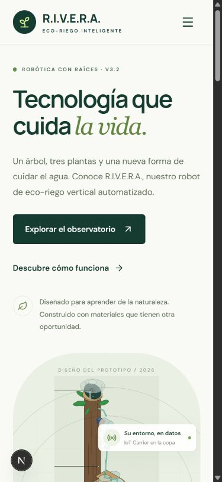

# R.I.V.E.R.A. 🌱

**Robot Inteligente Vertical de Eco-Riego Automatizado**

Página del proyecto R.I.V.E.R.A. v3.2, Robot Creativo, MideaBot 2026, UNAN-Managua. Una experiencia pensada primero para celulares: los jueces y asistentes podrán descubrir el prototipo desde un enlace NFC o un código QR cuando se publique.

> **Estado: versión preliminar 0.1, demostración local.** Los datos de sensores son ilustrativos. La consola no está conectada al robot y todavía no tiene autenticación. No introducir credenciales ni conectar actuadores reales en esta versión.

## Qué incluye

- Presentación del prototipo y explicación del recorrido del agua.
- Observatorio con cuatro tarjetas y gráficas de ejemplo claramente identificadas.
- Fichas interactivas de albahaca, hierbabuena y sábila.
- Consola de prueba: riego manual, cebado hacia el retorno, calibración temporal y parada.
- Recorrido guionado por las tres macetas con reloj virtual ×10; los tiempos simulados de bomba y servos conservan su duración.
- División de dosis en varias cargas si exceden la capacidad configurada de la cubeta.
- [Láminas completas del prototipo](frontend/public/rivera-v3.2.pdf).

## Rutas

| Ruta | Contenido |
| --- | --- |
| `/` | Sitio público y observatorio de demostración |
| `/admin` | Laboratorio de prueba; no es aún un panel protegido |

La navegación pública no enlaza al laboratorio. Conocer u ocultar su dirección no constituye una medida de seguridad.

## Stack

| Capa | Versión / elección |
| --- | --- |
| Framework | Next.js 16.4.5, App Router |
| Interfaz | React 19.3.1 y TypeScript |
| Diseño | CSS adaptable, Lucide React, gráficas SVG |
| Tipografía | DM Sans y Manrope; alternativas Arial y Georgia |
| Despliegue previsto | Vercel |
| Datos y usuarios, siguientes fases | Supabase |
| Comunicación futura con el MKR | HTTPS |

Supabase y la comunicación con el robot aún no están implementados. No se necesitan variables de entorno para esta primera versión. Las fuentes se solicitan a Google Fonts desde el navegador y cuentan con alternativas locales.

## Desarrollo local

Requisitos: Node.js **22 o superior**, compatible con Next.js 16, y npm. Usar una versión LTS vigente de Node.js.

```bash
git clone https://github.com/wigar03/R.I.V.E.R.A.git
cd R.I.V.E.R.A
git switch frontend
npm ci
npm run dev
```

Abrir [la web](http://127.0.0.1:3000/) o [la consola](http://127.0.0.1:3000/admin). El servidor de desarrollo escucha en el equipo local; esa URL no sirve como destino NFC en otros teléfonos.

```bash
npm run build       # Compilación de producción y validación de tipos
npm run typecheck   # Comprobación explícita de TypeScript
npm start          # Servir una compilación de producción
```

## Estructura

```text
frontend/
  app/                  Página pública, consola y estilos
  components/Rivera.tsx Interfaz y estado del simulador
  lib/model.ts          Modelo de demostración
  public/               Ilustraciones, PDF y captura móvil
  package.json          Dependencias y comandos de Next.js
  vercel.json           Configuración de despliegue del frontend
backend/
  README.md             Alcance y guía para el colaborador de backend
scripts/sync-push.mjs    Pull antes de cada push de una rama de trabajo
docs/COLABORACION.md     Flujo de ramas y configuración de despliegue
.github/workflows/      Validación de ramas, tipos y compilación
package.json            Workspaces y comandos comunes
package-lock.json       Dependencias bloqueadas del workspace
```

## Colaboración

Trabajamos en **frontend**; el otro colaborador trabaja en **backend**. Todo cambio
pasa por **develop** antes de **main**. Sincronizar antes de cada push con
`npm run sync:push` y abrir un pull request hacia develop. Consultar el
[flujo completo](docs/COLABORACION.md), incluidas las protecciones de GitHub y la
configuración de Vercel para el monorepo.

## Referencias del prototipo

| Elemento | Función en v3.2 |
| --- | --- |
| Servo 1, D9 | Vuelca la cubeta |
| Servo 2, D10 | Orienta el brazo distribuidor |
| Relé del UNO, D4 | Activa la bomba |
| Ultrasónico | Detecta presencia al frente |
| Sensor capacitivo | Referencia de suelo, únicamente en la maceta 2 |
| Sensor de agua | Detecta drenaje en el colector común |
| Tres LEDs | Iluminan los escalones |

Dosis iniciales del documento: **40 ml de albahaca, 35 ml de hierbabuena y 25 ml de sábila**. Ángulos de partida del brazo: 0°, 60°, 120° y 180° para el retorno. La capacidad de 40 ml conserva el dato del equipo y debe confirmarse en el montaje.

Caudal de 10 ml/s y tiempo inicial de 2 s son valores de ejemplo, no mediciones reales. El volumen se estima por tiempo; no existe un caudalímetro en esta propuesta. La calibración de la consola vive solo en memoria y se pierde al recargar.

## Hoja de ruta

| Fase | Alcance | Criterio de cierre |
| --- | --- | --- |
| **1 · Explorar y demostrar** | Sitio público, muestras de sensores, simulación local y diseño móvil | Validar diseño y secuencias con el equipo |
| **2 · Recibir sensores** | Supabase, API HTTPS y telemetría desde el MKR | Ver un cambio físico en la web y reconocer una desconexión |
| **3 · Operar con acceso privado** | Usuarios, permisos, calibración persistente y cola de órdenes | Ejecutar una orden autorizada una vez y recibir su resultado real |
| **4 · Preparar la exhibición** | Modelo ×10 en firmware, historial, límites de agua, Vercel, NFC y QR | Ensayar visita y reconexión sin repetir riegos |

### Telemetría propuesta

```text
MKR → API HTTPS en Vercel → Supabase → observatorio público
Administrador autenticado → API → cola de órdenes ← consultas del MKR
```

Comenzar probando envíos cada 5–10 s y consulta de órdenes cada 1–2 s; ajustar después al rendimiento y límites del servicio. Guardar por separado hora de medición y de recepción. Identificar unidad, origen y antigüedad de cada lectura.

Separar los datos medidos del ambiente de la demanda estimada por maceta. El sensor capacitivo no mide las tres macetas. El drenaje se atribuye a la maceta del ciclo activo, porque el colector es compartido.

### Órdenes reales: trabajo pendiente

- Autenticar administradores y validar permisos en el servidor y en la base de datos.
- Asignar a cada comando identificador único, emisor, caducidad y estados pendiente/aceptado/en ejecución/completado/fallido/cancelado.
- Evitar que un reinicio o reconexión repita una dosis; distinguir aceptación de finalización.
- Mantener las secuencias físicas en el firmware. La web envía órdenes de alto nivel; las funciones de Vercel no ejecutan un bucle de bombeo.
- Limitar cebado, capacidad, volumen total y duración. Apagar la bomba antes de mover servos y definir el comportamiento ante pérdida de red.
- Acelerar la acumulación de demanda del modelo ×10, conservando los tiempos calibrados de actuadores.

La demostración actual es guionada: todavía no implementa un modelo agronómico de evapotranspiración. Su parada actúa únicamente en la pantalla y no es un paro físico de emergencia.

## Prioridad móvil y verificaciones

Revisión en navegador con anchos simulados de **320, 360, 390, 430, 768 y 844 px**, incluida una vista horizontal del sitio público.

- Sin desbordamiento horizontal del documento en el sitio y las tres secciones de la consola.
- Texto ampliado, mejor contraste y controles táctiles de al menos 44 px en la experiencia móvil.
- Cabecera y menú adaptables; tarjetas en una columna para pantallas pequeñas.
- Campos numéricos de 16 px para evitar el zoom automático habitual de iOS.
- Barra inferior de parada durante la simulación, con espacio para el área segura.
- Probados menú, selección de planta, cebado, bloqueo de órdenes simultáneas, parada y validación de calibración.
- Compilación de producción y comprobación de tipos verificadas.

**Pendiente:** pruebas físicas en Safari/iPhone y Chrome/Android, apertura desde NFC/QR y lectura del PDF en el visor del teléfono. La revisión con tamaños simulados no equivale a una prueba en dispositivos reales.

<details>
<summary>Ver captura móvil</summary>



</details>

## Publicar en Vercel

1. Importar este repositorio en Vercel.
2. Seleccionar **Next.js**, usar **Root Directory = frontend** y permitir archivos fuera de ese directorio para instalar el workspace. Mantener **Production Branch = main**; las ramas de trabajo y develop se revisan en Preview.
3. El archivo `frontend/vercel.json` define `cd .. && npm ci` para instalar desde el lockfile de la raíz y `npm run build` para compilar; conservar la salida automática del framework. Si se escriben estos comandos en el panel, introducirlos sin comillas simples, comillas dobles ni acentos invertidos.
4. Esta versión no requiere secretos ni variables de entorno.
5. Tras obtener la URL pública estable, grabarla en el NFC y generar el QR de respaldo.

No incluir claves ni credenciales en Git. En las siguientes fases, las claves de servicio permanecerán en el servidor y el robot tendrá una credencial individual restringida. Si se comparte esta versión preliminar, mantener las etiquetas de demostración.

### Error de instalación: `npm ci: command not found`

Si el registro indica `Running "install" command: 'npm ci'` y `Command "'npm ci'" exited with 127`, se ha configurado el comando con comillas que lo convierten en un único nombre de ejecutable. Usar `npm ci` sin comillas. `frontend/vercel.json` fija el comando correcto desde el repositorio y tiene prioridad sobre el ajuste del panel para el despliegue correspondiente. Reintentar un despliegue antiguo conserva su configuración anterior. Revisar primero develop en Preview y publicar en main solamente tras aprobar la versión.

## Sobre esta entrega

La versión actual se incorpora al repositorio en **25 commits con cambios reales**, organizados por configuración, modelo, diseño, adaptación móvil, interfaz, recursos y documentación. Es una importación estructurada de la versión preliminar existente, no una reconstrucción de fechas históricas de trabajo.

Contenido técnico e ilustración basados en las láminas v3.2 suministradas por el equipo. No se declara una licencia de reutilización de terceros; corresponde al equipo decidir la licencia del proyecto.
